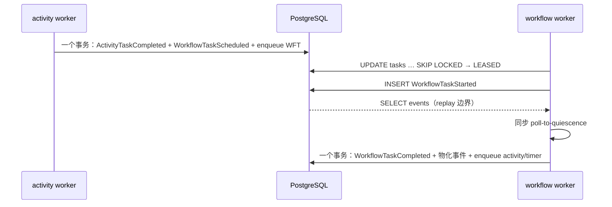

# oxidura 设计总览

用 Rust + 单个 PostgreSQL 复刻 Temporal 的**语义**（History / Replay / Workflow Task / Activity / Timer / Retry / Signal / Query / 版本化），刻意放弃它的**分布式架构**——我们只有一个数据库，很多「服务间」问题在单库下根本不存在。

**本文是范围、架构、数据模型与偏离表的唯一出处。** 决策原因在 `docs/adr/`，Temporal 原义对照在 `docs/concepts/`，里程碑与 gate 在 `docs/milestones/`。

## 1 词表

全仓库用这些 token 指同一件事，不要换说法。

| token | 含义 | 出处 |
|---|---|---|
| **replay 边界** | worker 读到的历史，**包含本轮 `WorkflowTaskStarted`**；`ctx.now()` 取这条事件的 `event_time` | ADR-0010 |
| **lease** | `tasks` 行的租约：默认 60s、每 20s 续租；`LEASED` 只能由 scanner 放开 | ADR-0011 |
| **scanner** | 后台循环，一切「到点发生的事」的唯一出口 | ADR-0012 |
| **gate** | 里程碑的完成定义：`scripts/verify-mN.sh` exit 0 | ADR-0015 |
| **seq** | 每轮重放内自 0 递增的命令序号；`activity_id` / `timer_id` 由它派生 | ADR-0014 |
| **三类失败出口** | execution failure / workflow-task failure / lease failure | ADR-0007 |
| **D 编号** | 偏离表（§5）里的条目；别处只引用编号 | 本文 §5 |

## 2 范围

**做**：M3 调度闭环 → P4 时间与重试完备 → P5 signal/query/patched/child/CAN/cancel → P6 sticky 基准与实验集。

**永不做**（不是「以后做」）：Namespace 多租户、Update、Schedules、Nexus、Archival、WorkerVersioning、Local Activity、Search Attributes / Memo / Priority / Header。理由见 ADR-0001。schema 里**不加**这些字段的空列。

## 3 架构

| crate | 职责 | 依赖 |
|---|---|---|
| `oxidura-core` | `Event` / `Command` / `HistoryEvent`、`apply_commands`、`replay` 引擎、`WorkflowContext`、`TestWorkflowEnvironment` | **无 tokio、无 sqlx**（gate 检查） |
| `oxidura-store-postgres` | migrations、`PgTaskQueue`、OCC 提交函数 | sqlx |
| `oxidura-sdk` | 门面：re-export core，给用户用的类型与注册辅助 | core |
| `oxidura-sdk-macros` | `#[workflow]` / `#[activity]` proc-macro | — |
| `oxidura-worker` | worker 循环、scanner、CLI（bin `oxidura`） | core + store + sdk |
| `examples/` | 每个里程碑的可跑 demo | 上列全部 |

依赖方向单向向内：**core 不认识 SQL，store 不认识工作流语义**。

进程拓扑：`oxidura worker --role workflow|activity|both`，默认两个进程（ADR-0004）。

## 4 数据模型

三张表，全部状态都在这里（没有 mutable-state 快照，D3）。

<!-- 形状见 ADR-0011；此处只放不变量 -->
1. `executions (workflow_id) WHERE status = 'RUNNING'` 唯一 —— 同一个 `workflow_id` 至多一条在跑的 run。
2. `events` 只追加，`PRIMARY KEY (run_id, event_id)`，`event_id` 从 1 起单调。
3. `tasks` 行处于 `LEASED` 时，**只有 scanner 能把它放开**。

## 5 偏离表

| D | Temporal 怎么做 | oxidura 怎么做 | 代价 | 回收时机 |
|---|---|---|---|---|
| D1 | 事件 envelope 带 `version` / `task_id` / `worker_may_ignore` | 只留 `event_id` / `event_time` / `attributes` | 无法做 worker versioning 类排查 | 永不做（随 §2） |
| D2 | `Payload{metadata, data: bytes}` + 全链路 DataConverter | `Payload = serde_json::Value`，`PayloadConverter` 只有 Json 实现 | 无 codec / 加密 / 非 JSON 编码 | 需要时加 trait 实现，不动签名 |
| D3 | `executions.data` 大 blob + 五张 `*_info_maps` 可变状态 | 无可变状态快照；只有 `next_event_id`/`status`/`db_record_version` + 任务行 | 每轮重放是 O(历史长度) | P6 用 sticky 缓存抵消，不引入快照 |
| D4 | `history_node` / `history_tree` 分页树 | 事件一张平表 | 超长历史全量读取代价高 | 不做 |
| D5 | 重试的中间尝试为 transient / buffered，不进历史 | 每次尝试都 materialize 进历史 | 历史因重试增长；与 Temporal 的 `attempt>1` 行为不同 | P6 实验集里实现对照版 |
| D6 | timer 由 History 分片的 timer 队列处理 | timer 与其它任务共用 `tasks` 表（`task_type=TIMER`） | 语义链条简化 | 不做 |
| D7 | 两级转移队列 + 事务性发件箱（跨服务） | 同事务 enqueue（单库下等价） | 无 | 不做 |
| D8 | 服务端 query 分发（不落库；具体路径未核实） | query 走 `tasks` 行（`task_type=QUERY`），结果列轮询 | query 依赖 worker 在跑 | 不做 |
| D9 | SDK 级 cancel scope | `futures` 组合子 + drop 表达取消 | 取消语义不完全等价 | 不做 |
| D10 | — | §2 的「永不做」清单 | 少若干概念实践 | 不做 |
| D11 | `GetVersion(change_id, min, max)` | `ctx.patched(change_id) -> bool` | 无多版本区间 | 不做 |
| D12 | 快照列 / 跨机缓存 | P6 只加内存 LRU + sticky 队列名 | 缓存不跨进程共享 | 不做 |
| D13 | Go SDK 在无 channel 时丢弃早到的 signal | signal 保留在 ctx 缓冲，等待者到达时按到达顺序消费 | 语义更宽容；非确定性保护更弱 | 不做 |
| D14 | 默认 activity RetryPolicy 由服务端动态配置，重试受 `schedule_to_close_timeout` 兜底 | M3 用引擎配置上限；P4 落成 `schedule_to_close` | M3 的上界不是 Temporal 的那个 | P4 |

## 6 里程碑

| 里程碑 | 一句话 | gate | 明确不做 |
|---|---|---|---|
| [M0](milestones/m0.md) | 骨架：workspace、工具链、dev-pg、docs | `scripts/verify-m0.sh` | 引擎逻辑、表 |
| [M1](milestones/m1.md) | 纯内存重放内核 | `scripts/verify-m1.sh` | DB、async runtime、宏 |
| [M2](milestones/m2.md) | 存储与任务队列 | `scripts/verify-m2.sh` | worker 循环、timer、重试 |
| [M3](milestones/m3.md) | 调度闭环（MVP） | `scripts/verify-m3.sh` | 持久化 timer、NOTIFY、signal |
| [P4](milestones/p4.md) | 时间与重试完备 | `scripts/verify-p4.sh` | local activity |
| [P5](milestones/p5.md) | 高阶语义 | `scripts/verify-p5.sh` | Update、cancel scope、`ctx.spawn` |
| [P6](milestones/p6.md) | sticky 基准与实验集 | `scripts/verify-p6.sh` | 快照列、跨机缓存 |

细节、验收断言、演示命令在各自的里程碑页；每页的 Gate 段就是完成定义。

## 7 索引

**概念**（Temporal 怎么做 → 我们怎么做 → 代价）：

[Workflow Task](concepts/workflow-task.md) · [History 与 Events](concepts/history-and-events.md) · [Replay](concepts/replay.md) · [Determinism](concepts/determinism.md) · [Task Queue 与租约](concepts/task-queue-and-lease.md) · [Timers](concepts/timers.md) · [Retry 与 Failure](concepts/retry-and-failure.md) · [Signals 与 Queries](concepts/signals-and-queries.md) · [Child Workflow 与 CAN](concepts/child-workflow-and-continue-as-new.md) · [Sticky Cache](concepts/sticky-cache.md) · [Versioning](concepts/versioning.md)

**决策**：

[0001 范围与永不做](adr/0001-scope-and-never-do.md) · [0002 全量重放模型](adr/0002-full-replay.md) · [0003 同步 poll-to-quiescence](adr/0003-sync-poll-to-quiescence.md) · [0004 工作区分层](adr/0004-workspace-layout.md) · [0005 事件与命令保真度](adr/0005-event-command-fidelity.md) · [0006 类型形状与序列化](adr/0006-types-and-serialization.md) · [0007 失败出口与超时](adr/0007-failure-exits-and-timeouts.md) · [0008 Command→Event 物化](adr/0008-command-materialization.md) · [0009 SDK 人体工学](adr/0009-sdk-ergonomics.md) · [0010 匹配算法与确定性时钟](adr/0010-matching-and-deterministic-clock.md) · [0011 任务队列与租约](adr/0011-task-queue-and-lease.md) · [0012 时间触发转移](adr/0012-time-triggered-transitions.md) · [0013 Activity 失败与重试](adr/0013-activity-failure-model.md) · [0014 确定性 ID](adr/0014-deterministic-ids.md) · [0015 里程碑与 gate](adr/0015-milestones-and-gates.md) · [0016 P6 基准设计](adr/0016-phase6-benchmark.md)。
